# probabilistic-record-linkage

**Finds the records that describe the same person across messy databases, and refuses to merge two
different people quietly.**

Every organization ends up with the same person stored several times: once from the web form, once
from the call centre, once from a supplier file. The copies never match exactly. A name is
misspelled, a nickname replaces a legal name, a day and month are swapped, an address is two years
out of date, a field is blank. Joining on an exact key finds only 59% of these duplicates on this
project's data, so the rest stay invisible: the same patient gets two conflicting medication
histories, the same customer is billed twice, the same supplier is paid twice, and a churn model
trained on those records learns from people who do not exist. The opposite mistake is worse. Merging
two different people, a pair of twins or two members of one household, joins their medical records
or their debts, and once records are merged, untangling them is slow, manual and often impossible.

This repository is a working entity-resolution system for that problem. It decides which records
belong to the same person using a statistical model that needs no labelled training examples, it
measures its own accuracy against known ground truth, it sends the cases it cannot settle to a
human, and it includes a mode that links records between two organizations without either one
handing over names. That privacy mode is not asserted to be safe: it is attacked in this repository,
and the attack succeeds against the naive version.

Everything runs offline on a CPU, with no paid API key. Generating 200,000 records takes 3.2
seconds and linking them takes 25.1 seconds on a 6-core laptop.

## What this does

- **Matches people, not strings.** Two records can differ in every field and still be the same
  person. The model weighs each field's agreement by how much evidence it really carries: sharing a
  rare surname is strong evidence, sharing a birth date is weaker, sharing a sex is almost none.
- **Learns the weights from the data, unsupervised.** Unsupervised means no human-labelled
  examples. Nobody has to mark pairs as "same person" first, which matters because that labelling
  is the expensive part of every real deduplication project.
- **Skips the pairs that cannot match.** Comparing 199,684 records pair by pair means 19.9 billion
  comparisons. A blocking step (cheap pre-filter for plausible pairs) cuts that to 5.3 million,
  0.026% of the total, while still keeping 99.2% of the true duplicates.
- **Escalates instead of guessing.** Pairs the model is unsure about, twin-like matches, and
  clusters that look like several people glued together are held for a human. Reviewer decisions
  become hard constraints, and each one is appended to a tamper-evident log.
- **Links across organizations without sharing names.** Each side converts its fields into keyed
  Bloom filters (bit fingerprints of a name, not the name) and only the fingerprints are compared.
  The repository then attacks those fingerprints to show how much privacy they actually buy.

## Architecture

```mermaid
flowchart LR
    subgraph world["Synthetic world (seeded)"]
        vocab["Zipfian syllable vocabularies<br/>3 name-origin groups"] --> people["Population<br/>twins, households"]
        people --> corrupt["Corruption model<br/>typos, nicknames, swaps, moves"]
        corrupt --> sources[("5 sources<br/>Parquet")]
        people --> truth[("Ground truth<br/>separate directory")]
    end
    sources --> contract["pandera contract<br/>strict columns"]
    contract --> norm["Normalize +<br/>dictionary-encode"]
    norm --> lsh["MinHash LSH<br/>name bigrams"]
    norm --> sn["Sorted neighbourhood<br/>DOB + Soundex"]
    lsh --> cand["Candidate pairs"]
    sn --> cand
    cand --> cmp["Agreement levels<br/>Jaro-Winkler, nickname,<br/>date distance, address"]
    cmp --> fs["Fellegi-Sunter<br/>u: random pairs<br/>m: EM on training blocks<br/>+ term frequency"]
    fs --> thr["Label-free thresholds<br/>+ twin review rule"]
    thr --> guard["Clusters +<br/>over-merge guard"]
    guard --> store[("DuckDB<br/>clusters, edges, review queue")]
    store --> api["FastAPI<br/>jobs, entities, review"]
    api --> audit[("Hash-chained<br/>audit log")]
    fs --> reg[("Registry<br/>model.json + manifest")]
    norm -. "privacy mode" .-> bloom["Keyed Bloom filters<br/>+ keyed blocking tokens"]
    bloom -.-> cmp
```



### How a linkage job flows, in words

A caller posts a batch of records to `POST /v1/link-jobs` (or runs the `link` CLI command). Then:

1. **Check the shape.** Each source file is validated against a strict contract: required columns,
   field formats, field lengths, row limits. Any extra column is rejected, including the ground
   truth's `entity_id`, so the evaluation cannot leak into the linker.
2. **Tidy the values.** Case, punctuation and street suffixes are normalized ("Saint" and "St",
   "Street" and "St"), then each column is dictionary-encoded so later stages compare integers.
3. **Pick the pairs worth looking at.** Two independent passes propose candidates: MinHash LSH over
   name bigrams (records whose names share enough two-letter fragments land in the same bucket), and
   three sorted-neighbourhood sweeps over composite keys built from date of birth, Soundex codes and
   birth year. Their union is the candidate set. Oversized buckets, the "John Smith" problem, are
   paired through a sliding window instead of all against all.
4. **Score each field's agreement, not just equal/unequal.** Every candidate pair gets a discrete
   level per field: exact, a Jaro-Winkler similarity band, nickname equivalence, a swapped
   day/month, a one-component date error, missing, or disagreement. The address is one combined
   comparison rather than three ([ADR 0003](docs/adr/0003-address-as-one-hierarchical-comparison.md)).
5. **Learn what each level is worth.** For each field level the model needs two numbers: `m`, how
   often true duplicates agree at that level, and `u`, how often unrelated people do. `u` comes from
   random record pairs; `m` comes from EM (an iterative fit that works without labels) over counts
   of comparison patterns on training blocks. A rare-name bonus (term-frequency adjustment) makes
   agreement on an uncommon value count for more than agreement on a common one.
6. **Turn weights into a decision, without labels.** Pairs above the match threshold are merged;
   the threshold is chosen so the model's own expected false-discovery rate stays at or below 1%. A
   review band below it keeps expected missed matches under 0.2% and is capped at 5,000 pairs. A
   `possible_twin` rule pushes twin-like matches into review regardless of their score.
7. **Build people out of pairs, carefully.** Matched pairs form a graph; connected groups become
   entities. Because "A matches B" and "B matches C" forces A and C together, one wrong edge can
   merge two people, so an over-merge guard inspects every group and splits the suspicious ones
   ([ADR 0005](docs/adr/0005-over-merge-guard.md)). Groups it cannot settle are marked
   `pending_review` and never committed automatically.
8. **Persist, serve, and record.** Clusters, edges and the review queue go to DuckDB. The API serves
   entity lookups and the review queue; reviewer decisions become must-link and cannot-link
   constraints, are hash-chain audited, and only then are clusters recomputed. The fitted model is
   written to a content-addressed registry as canonical JSON.

Each stage emits one OpenTelemetry span, and the code lives under
`src/probabilistic_record_linkage/linkage/`.

### How it works, for engineers

| Component | File | Responsibility |
|---|---|---|
| Generator | `linkage/generator.py`, `linkage/corruption.py` | Seeded synthetic population (twins, households) plus a configurable corruption model; truth written to a separate directory |
| Contracts | `ml/contracts.py` | Strict pandera (Polars) schemas per source |
| Blocking | `linkage/blocking.py` | MinHash LSH (120 permutations, 20 bands) unioned with three sorted-neighbourhood passes |
| Comparison | `linkage/comparison.py` | Discrete agreement levels via rapidfuzz, nickname table, date arithmetic |
| Model | `linkage/fellegi_sunter.py` | `u` from random pairs, `m` by EM over pattern counts, prior by one-parameter EM, term-frequency adjustment |
| Thresholds | `linkage/thresholds.py` | Label-free match and review bands from the fitted distribution |
| Clustering | `linkage/clustering.py` | Connected components plus the three-rule over-merge guard |
| Privacy | `linkage/privacy.py`, `linkage/attack.py` | HMAC-keyed Bloom-filter encodings, keyed blocking tokens, and four attacks against them |
| Service | `api/`, `linkage/service.py` | Batch jobs, entity lookup, review queue, constraints, audit chain |
| Registry | `ml/registry.py`, `linkage/model.py` | Canonical JSON artifacts with SHA-256 verification and a reproducibility manifest |

**The key trade-off.** Fellegi-Sunter multiplies per-field evidence as if the fields were
independent given match status. They are not. A record copied between two systems agrees
everywhere at once, so the model counts one piece of evidence several times and becomes
over-confident. This is measured rather than mentioned: inside the match band the model predicts a
false-discovery rate of 0.2% and delivers 2.3%, a factor of ten (see Results). Treat a threshold's
`expected_fdr` as a lower bound. The over-merge guard and the twin review rule exist because the
score alone cannot be trusted at the edges.

**Why this approach over the obvious alternative.** The obvious alternative is a supervised
classifier on labelled pairs. On this data a logistic regression trained on 1% labels reaches F1
0.9870 against the unsupervised model's 0.9909, so the labels buy nothing here, and in a real
project they cost weeks of clerical work and have to be redone for every new source.

A second, subtler alternative is to run EM directly on the candidate pairs that blocking produced.
That is the textbook reading of the specification, and it breaks at scale: blocking deliberately
selects pairs that agree on names or birth dates, so non-matching candidates agree on the blocked
fields far more often than random pairs do, and in a correlated way that conditional independence
cannot represent. Measured at 199,684 records, EM on candidates misestimates the address `m` by
0.0836 against the analytic value, against 0.0178 for the estimator used here. That is the whole
argument of [ADR 0002](docs/adr/0002-u-from-random-pairs-and-training-blocks.md).

ADRs: [0001 recording decisions](docs/adr/0001-record-architecture-decisions.md) ·
[0002 `u` from random pairs and `m` on training blocks](docs/adr/0002-u-from-random-pairs-and-training-blocks.md) ·
[0003 address as one hierarchical comparison](docs/adr/0003-address-as-one-hierarchical-comparison.md) ·
[0004 privacy-mode hardening and keyed blocking](docs/adr/0004-privacy-mode-hardening-and-keyed-blocking.md) ·
[0005 the over-merge guard](docs/adr/0005-over-merge-guard.md)

## Results

Every number below was copied from benchmark output recorded on 2026-09-20 on Windows 10
(10.0.19045), 6 logical CPUs, Python 3.12.14, CPU only. The data comes from the seeded generator
(seed 20260913) at its default corruption settings. Each benchmark writes its raw JSON under
[`bench/results/`](bench/results/), committed next to these tables, and CI re-runs the same scripts
against thresholds. Every claim maps to evidence in [CLAIMS.md](CLAIMS.md).

### Accuracy and speed

Command: `uv run python bench/bench_linkage.py --records 200000 --check`
(CI runs the same script with `--records 20000`, job `e2e-20k`).

| Metric | 20,002 records | 199,684 records | Target |
|---|---:|---:|---:|
| Candidate pairs | 154,753 | 5,279,295 | |
| Blocking pair completeness | 0.9945 | 0.9918 | >= 0.98 |
| Blocking reduction ratio | 0.999226 | 0.999735 | >= 0.999 |
| Pairwise precision | 0.9954 | 0.9940 | |
| Pairwise recall | 0.9900 | 0.9879 | |
| **Pairwise F1** | **0.9927** | **0.9909** | >= 0.95 |
| B-cubed F1 | 0.9957 | 0.9948 | |
| Baseline: exact normalized key, F1 | 0.7536 | 0.7458 | |
| Baseline: logistic regression on 1% labels, F1 | 0.9866 | 0.9870 | |
| EM max abs m(exact) error vs analytic, training blocks | 0.0090 | 0.0178 | <= 0.03 |
| EM max abs m(exact) error, EM on candidate pairs | 0.0108 | 0.0836 | (comparison) |
| EM max abs m error over **all** levels | 0.0189 | 0.0216 | <= 0.03 |
| EM max abs u error over **all** levels | 0.0013 | 0.0008 | <= 0.01 |
| ECE over candidate pairs | 0.00349 | 0.00125 | |
| Twin false-merge rate (after review routing) | 0.1212 | 0.0860 | |
| Twin false-merge rate from probability bands alone | 0.9394 | 0.9362 | |
| Household false-merge rate | 0.0134 | 0.0180 | |
| Link time, all stages | 1.57 s | 25.13 s | |
| Throughput | 12,778 records/s | 7,946 records/s | |

What those numbers mean, in the order a reader usually cares about them.

- **Pairwise F1 0.9909** is the balance of two mistakes. Precision 0.9940 means that of every 1,000
  pairs the system merged, about 6 should not have been merged. Recall 0.9879 means that of every
  1,000 pairs that truly are the same person, it found about 988.
- **Exact-key F1 0.7458** is what a plain SQL join on a cleaned name-and-birth-date key achieves on
  the same data. It never merges the wrong people (precision 1.0) but finds only 59% of the
  duplicates, so 41% of the problem is simply not visible to it.
- **Logistic regression on 1% labels, F1 0.9870**, is a supervised model given 53,068 labelled
  pairs. It lands 0.4 F1 points *below* the model that was given no labels at all.
- **Reduction ratio 0.999735** means blocking threw away 99.9735% of the 19.9 billion possible
  pairs. **Pair completeness 0.9918** is the price: 0.8% of true duplicates were never proposed as
  candidates, so no scoring can recover them. That 0.8% is the ceiling on recall.
- **Twin false-merge rate 0.0860 versus 0.9362** is the review queue earning its place. Scores
  alone merge 94% of twin pairs, because identical twins share a surname, an address and a birth
  date. Routing twin-like matches to a human brings it to 8.6%.
- **EM m(exact) error 0.0178** means the model, with no labels, recovered each field's true
  agreement rate to within 1.8 percentage points of the value derivable analytically from the
  generator's corruption rates. It learned the right thing, not merely a useful thing.
- **7,946 records/s** is end-to-end single-process throughput: validate, block, compare, fit,
  score, threshold and cluster 199,684 records in 25.13 seconds on a laptop.

Stage timings at 199,684 records: validate 0.35 s, normalize 0.33 s, block 17.62 s, compare 2.57 s,
EM 1.47 s, score 0.31 s, threshold 0.49 s, cluster 1.80 s. Blocking is 70% of the run. Fitting the
model, the part that sounds expensive, takes 1.47 s because EM runs over counts of distinct
comparison patterns rather than over pairs.

Accuracy by synthetic name-origin group at 199,684 records (precision / recall / F1): north 0.9947
/ 0.9882 / 0.9915, south 0.9926 / 0.9875 / 0.9900, east 0.9934 / 0.9872 / 0.9903. The spread is
0.15 F1 points, which is the check that quality does not depend on which vocabulary a name came
from.

Two footnotes on the EM rows, because they are easy to misread. The "all levels" rows compare the
whole fitted vectors against labelled data: `m` against matching candidate pairs and `u` against
non-matching *random* pairs, which is what `u` models. Comparing `u` against non-matching
*candidate* pairs instead gives 0.334 at 20,000 records. That is not an error; it is a measurement
of how selective blocking is, and it is exactly why `u` is not estimated from candidate pairs.

### Robustness, the guard, drift and privacy

Command: `uv run python bench/bench_robustness.py --check` (20,000 records; the privacy section runs
on 50,206 records; 47.5 s total; CI job `robustness`).

Accuracy as the data gets dirtier. Every corruption rate (typo, nickname, missing field, date
error, move) is scaled by the same factor, so 2.0 is roughly twice as messy as the default.

| Corruption rates scaled by | 0.5 | 1.0 | 1.5 | 2.0 |
|---|---:|---:|---:|---:|
| Pairwise F1 | 0.9975 | 0.9927 | 0.9874 | 0.9822 |

Doubling every error rate costs about 1 F1 point. The degradation is gradual, not a cliff.

**Calibration**, meaning: when the model says a pair is 95% likely the same person, is it right 95%
of the time? Two scenarios: independent corruption, and correlated corruption where the same
marginal error rates are concentrated in 10% of records ("sloppy" sources). The aggregate ECE
(expected calibration error) hides almost everything, so the two bands where a wrong probability
costs something are reported next to it.

| Calibration | Independent corruption | Correlated corruption |
|---|---:|---:|
| Pairwise F1 | 0.9927 | 0.9896 |
| ECE over all candidate pairs | 0.00349 | 0.00290 |
| Uncertain band (0.01 <= p <= 0.99): pairs | 1,699 (1.1%) | 1,836 (1.2%) |
| Uncertain band: ECE | 0.1443 | 0.0712 |
| Uncertain band: expected vs observed FDR | 0.750 vs 0.895 | 0.721 vs 0.778 |
| Match band: pairs | 20,334 (13.1%) | 20,120 (13.0%) |
| Match band: ECE | 0.0207 | 0.0203 |
| Match band: expected vs observed FDR | 0.0022 vs 0.0229 | 0.0028 vs 0.0227 |

Two honest readings. First, the aggregate ECE is a weak probe: the same model that looks calibrated
to 0.003 over all candidate pairs is off by 0.14 where it is unsure, because 98.9% of candidate
pairs are obvious non-matches and drown out the rest. Second, the project's own specification
expected correlated errors to *hurt* calibration. They do not, here: correlated corruption costs
0.3 F1 points but its ECE is lower in both bands. What the bands do show is over-confidence in both
regimes. Inside the match band the model predicts a 0.2% false-discovery rate and delivers 2.3%.
Conditional independence inflates the weight of fields that agree together for a shared reason, so
`expected_fdr` is a lower bound, not a guarantee.

**The over-merge guard**, tested against deliberate sabotage: 104 adversarial bridge records
injected into 40 household chains, each bridge record copying one household member's name and the
next member's birth date and address, so it looks like two people at once.

| | With guard | Without guard |
|---|---:|---:|
| Max real people in an auto-committed cluster touched by a bridge record | **2** | 4 |
| Max real people including clusters held for review | 2 | 4 |
| Touched clusters held for review (`pending_review`) | 2 | 0 |
| Max identities including bridge records | 4 | 8 |
| Pairwise F1 on the same data without bridge records | 0.9927 | 0.9786 |

Without the guard, one crafted record can weld four real people into a single "person". With it, no
automatically committed cluster contains more than two, and the two worst cases are held for a
human instead. The guard also improves ordinary accuracy (0.9786 to 0.9927), mainly by separating
household members, so it is not a safety feature bought with recall.

**Drift**, meaning: does the system notice when a new data source behaves differently from the one
the model was fitted on?

| Comparison-pattern PSI of likely matches, new source vs model reference | PSI | Alarm (> 0.2) |
|---|---:|---|
| New source, same corruption | 0.016 | no |
| New source, 3x corruption | 0.554 | yes |

**Privacy mode** on 50,206 records (plaintext F1 on the same data: 0.9925). Two questions are asked
at once: how much accuracy is lost by never seeing names, and how many names an attacker can
recover from the encodings anyway. Four attacks run on the 100 most frequent first-name encodings,
and the worst result is reported: three frequency-alignment strategies (global, length-stratified,
salt-aware) and a graph-matching attack that lines up the similarity structure of the encodings
against the similarity structure of a public name list.

| Encoding | F1 | F1 drop | Best frequency alignment | Graph matching | Worst | Filter-name similarity correlation |
|---|---:|---:|---:|---:|---:|---:|
| Keyed Bloom filters, unhardened | 0.9764 | 1.61 pp | 0.20 | **0.77** | 0.77 | 0.868 |
| Hardened, birth-year salt (default) | 0.9666 | 2.59 pp | 0.10 | 0.00 | 0.10 | 0.006 |
| Hardened, birth-year + birth-month salt | 0.9473 | 4.52 pp | 0.01 | 0.00 | 0.01 | -0.037 |

Read the first row as a warning, not a feature. Unhardened keyed Bloom filters are **not** private:
the graph-matching attack correctly names 77 of the 100 most frequent encodings, because the
similarity between two bit fingerprints tracks the similarity between the two names almost exactly.
The last column measures that premise directly
(`linkage.attack.similarity_correlation`): the Pearson correlation between the similarity matrix of
the 300 most frequent encodings and the similarity matrix of their true names' letter-fragment sets.
Hardening drives it from 0.868 to 0.006, and the same attack then recovers nothing; what survives is
the salt-aware frequency alignment at 10%.

The specification asked for an F1 drop of at most 3 pp *and* attack recovery of at most 5%. **No
measured setting meets both.** The default meets the accuracy target and cuts the worst attack from
77% to 10%; the stronger salt reaches 1% but loses 4.52 F1 points. That failure is asserted rather
than narrated: `tests/integration/test_privacy_gate.py` runs on the same 50,000 records, seed and
key as the benchmark, and the 5% goal for the default is a `strict=True` xfail, so the suite breaks
the day the default meets it and the xfail is left behind. The CI threshold of 0.15 for the default
is a regression guard at the measured level, not the target.

### Micro-benchmarks

Command: `uv run python bench/bench_baseline.py --check` (CI job `bench`). One recorded run,
committed as [`bench/results/latest.json`](bench/results/latest.json). p95 on a laptop moves by tens
of percent between runs, which is why `bench/thresholds.json` is loose.

| Benchmark | Runs | p50 (us) | p95 (us) |
|---|---:|---:|---:|
| redact_text_1kb | 2000 | 436.0 | 512.5 |
| rate_limiter_check | 20000 | 1.8 | 1.9 |
| drift_check_10k_vs_10k | 30 | 2154.8 | 2450.0 |
| em_fit_500k_pairs_4_inits | 10 | 188701.5 | 206427.0 |
| minhash_signatures_10k_names | 10 | 198561.9 | 221589.6 |
| jaro_winkler_100k_pairs | 10 | 33712.9 | 39514.6 |

p50 1.8 us for `rate_limiter_check` means half of all rate-limit checks finished within 1.8
microseconds. These are single-machine numbers for catching regressions, not performance claims.

## Security

The records here are synthetic, but the system is built and tested as if they were real personal
data: a name, a birth date, an address, and the far more sensitive fact that two records belong to
the same person. Threats, controls and their tests are in
[docs/THREAT_MODEL.md](docs/THREAT_MODEL.md) (STRIDE per trust boundary).

**In plain terms, what is defended:**

- Nobody sees a person's name or address unless their token explicitly grants it. Reading which
  records belong to one person is a separate permission from reading the fields themselves.
- Nobody can read someone else's linkage job, even knowing its id.
- Nothing can merge two people silently. When the system is unsure, a human decides, and that
  decision cannot be edited or deleted afterwards without detection.
- Personal data does not leak sideways into logs, metrics or traces, which are usually the least
  protected copies of a system's data.
- In privacy mode the key that turns names into fingerprints never lives in an environment variable
  or an image layer.

**And the mechanisms:**

- **Access control.** JWTs verified with HS256 pinned, required claims and a capped lifetime. Scopes
  are `link:run`, `entity:read`, `review:write` and `pii:read`. Without `pii:read`, entity lookups
  and review items return record ids and match probabilities only. Routes fail closed when no secret
  is configured. Every job is owned by its token's `tenant` claim (or its subject), and all
  `/v1/link-jobs/{job_id}` routes answer 404 to any other owner, so a leaked job id yields nothing.
- **No silent over-merges.** Clusters above the size cap, or that still conflict with a reviewer's
  cannot-link, are `pending_review` and never auto-committed. Twin-like matches go to review.
  Reviewer decisions are appended to a SHA-256 hash chain whose head is returned for external
  anchoring; the log detects single-byte edits, deletions, reordering, re-encoding, type coercion
  and truncation.
- **Logs and telemetry.** Names, birth dates and addresses are masked in logs, both as structured
  fields and as dates and street addresses inside free text (including tracebacks). Metrics carry no
  record ids; spans carry counts and HMAC pseudonyms.
- **Privacy mode.** The Bloom-filter key is read only from a mounted secret file (regular file, no
  symlinks, 32-4096 bytes, owner-only on POSIX). The attacks run in CI and gate the hardening
  defaults at the benchmark's own scale.
- **Limits.** Uploads are bounded by body size, row count, field length, field format and the strict
  contract; contract failures never echo values. Rate limits apply per token subject, and job
  concurrency is capped per client and globally.
- **Artifacts and secrets.** Models are JSON verified by SHA-256. There is no pickle anywhere, and a
  test plus a semgrep rule keep it that way. Secrets come from the environment or mounted files, and
  only `.env.example` is committed.
- **CI.** ruff, mypy --strict, pytest with an 85% line-and-branch coverage floor, bandit, semgrep
  with repository rules, pip-audit, gitleaks, hadolint, a trivy image scan and a syft CycloneDX
  SBOM, plus the linkage and robustness benchmarks against thresholds. Reporting is described in
  [SECURITY.md](SECURITY.md).

## Quickstart

Requirements: [uv](https://docs.astral.sh/uv/) and Python 3.12. No API key, no network, no paid
service. All data is generated locally.

```bash
uv sync --frozen
uv run python tasks.py demo
```

The demo prints one JSON summary. It generates a 20,000-record multi-source dataset with hidden
ground truth, links it, scores the result (pair completeness,
reduction ratio, pairwise and B-cubed F1, EM recovery error, twin and household false-merge rates),
registers the model with its reproducibility manifest, checks readiness, finds a real twin pair that
the review rule caught, resolves it through the CLI, verifies the audit chain, then runs privacy
mode with every implemented attack against plain and hardened encodings, and finishes with a drift
check on a source corrupted three times as heavily. Expect a pairwise F1 near 0.99 and a drift alarm
that fires on the shifted source and not on the unshifted one.

Two more entry points:

```bash
uv run python tasks.py check   # ruff, mypy --strict, pytest + coverage, bandit, pip-audit, baseline
uv run python tasks.py bench   # micro-benchmarks, 20k linkage and robustness, with thresholds
```

On Windows with a small repository drive, put the environment elsewhere first:
`$env:UV_PROJECT_ENVIRONMENT = "C:/Users/<you>/.venvs/probabilistic-record-linkage"`.

Step by step with the CLI, if you want to see each stage:

```bash
uv run probabilistic-record-linkage generate --records 20000 --out var/data
uv run probabilistic-record-linkage link --data var/data --workdir var/state --register
uv run probabilistic-record-linkage review list --workdir var/state --job <job_id>
uv run probabilistic-record-linkage review decide --workdir var/state --job <job_id> \
    --item <item_id> --decision non_match --reviewer alice
uv run probabilistic-record-linkage entity --workdir var/state --job <job_id> --record s1-0000001
uv run probabilistic-record-linkage audit verify var/state/audit/review-decisions.jsonl
```

Privacy mode links the same dataset from keyed Bloom-filter encodings. The key is read only from a
mounted secret file named by `APP_PPRL_KEY_FILE` (or `--key-file`); there is no inline-key path:

```bash
APP_PPRL_KEY_FILE=/run/secrets/pprl_key     uv run probabilistic-record-linkage private-link --data var/data
```

HTTP service (every `/v1` route needs a JWT carrying the named scope):

```bash
export APP_JWT_SECRET="<at least 32 characters>"
uv run probabilistic-record-linkage issue-token --subject alice --scope link:run --scope entity:read
uv run probabilistic-record-linkage serve
curl -s -H "Authorization: Bearer <token>" http://127.0.0.1:8000/v1/link-jobs/<job_id>
```

| Route | Scope |
|---|---|
| `POST /v1/link-jobs` | `link:run` |
| `GET /v1/link-jobs/{job_id}` | `link:run` |
| `GET /v1/link-jobs/{job_id}/entities/{record_id}` | `entity:read`, plus `pii:read` for fields |
| `GET /v1/link-jobs/{job_id}/review-items` | `review:write`, plus `pii:read` for fields |
| `POST /v1/link-jobs/{job_id}/review-items/{item_id}/decision` | `review:write` |

Jobs belong to the token's `tenant` claim (`issue-token --tenant acme`), or to the token subject
when there is none. Every `{job_id}` route answers 404 to any other owner, so a submitting service
account and its reviewers can share a tenant while other tenants cannot see the job.

`docker compose up --build` runs the non-root, read-only image with a data volume and the privacy key
as a mounted secret (see the comments in `docker-compose.yml`). The image was built and smoke-tested
locally on 2026-09-20 with Docker 29.6.1: it runs as uid 10001 on a read-only root filesystem with
`cap_drop: ALL`, and its `HEALTHCHECK` (`/healthz`) reports `healthy`. hadolint, the trivy scan and
the syft SBOM run only in CI (job `docker`).

## Non-goals

What this repository deliberately does not do, and where its evidence stops.

- **Incremental resolution with stable cluster ids.** Cluster ids are the smallest row index of a
  batch run, and every job resolves its whole batch.
- **EM-refined `u` on candidate pairs.** `u` is estimated from random pairs and held fixed, which
  deviates from the specification's "initialized from random pairs" and is kept only as an
  optional strategy ([ADR 0002](docs/adr/0002-u-from-random-pairs-and-training-blocks.md)).
- **Meeting both privacy targets at once.** At 50,206 records the default loses 2.59 F1 points and
  the worst attack recovers 10% of the top 100 names; the stronger salt reaches 1% but loses 4.52
  points. The 5% goal for the default is a `strict=True` xfail in the test suite, not a silence.
- **Resistance to every cryptanalysis.** Frequency alignment and graph matching are implemented and
  run on every benchmark and gate. Pattern-mining attacks (Christen et al. 2017) are not: they need
  to isolate the bit positions of one q-gram, and at 512 bits, 12 hashes and about 400 distinct
  q-grams roughly nine q-grams share each position, so positions of different q-grams co-occur as
  often as positions of the same one. The keyed blocking tokens are deterministic and reveal their
  own frequency distribution.
- **Privacy mode over HTTP.** The API links plaintext batches only; privacy mode is reachable from
  the library, the `private-link` CLI command, the demo and the benchmark.
- **Term-frequency adjustment and LSH in privacy mode.** Both would need the frequency or bit
  structure that hardening removes.
- **A guarantee against every bridge attack.** Several bridge records per pair of people, or a
  bridge record strongly matching one person, can defeat the guard's rules. Those clusters are held
  for review or kept, as the robustness table shows.
- **A real nickname list.** Names are synthetic, so the nickname table is derived from the
  synthetic vocabulary and shipped with each generated dataset as reference data.
- **A review user interface.** Review happens through the API or the CLI
  ([docs/REVIEW_RUNBOOK.md](docs/REVIEW_RUNBOOK.md)).
- **Distributed deployment.** DuckDB is an embedded single-process store, rate limits and job caps
  are per process, and telemetry is exported to the console or nowhere (no OTLP exporter).
- **Encryption at rest.** The DuckDB store and generated Parquet files hold personal data in the
  clear; use an encrypted volume.
- **Real-world accuracy.** All results are on synthetic data with a known corruption model. Real
  data has error patterns this generator does not simulate.
- **An out-of-distribution evaluation.** Every accuracy number comes from this repository's own
  generator, and the analytic EM check uses the same corruption model, so the evidence is
  self-consistent by construction. A second generator with different error processes (FEBRL-style),
  an ablation table (term-frequency adjustment on/off, LSH versus sorted neighbourhood), a
  multi-bridge adversarial benchmark and a profiled blocking stage (70% of the 200k runtime) are
  known gaps, not claims.
- **An incremental git history.** The first nine commits were made from a finished tree at the end
  of the initial build; the fix commits after them are incremental. Timestamps were never forged.

## References

- I. P. Fellegi and A. B. Sunter, "A Theory for Record Linkage", JASA 64(328), 1969.
- W. E. Winkler, "Using the EM Algorithm for Weight Computation in the Fellegi-Sunter Model of
  Record Linkage", 1988; "String Comparator Metrics and Enhanced Decision Rules", 1990.
- A. Z. Broder, "On the resemblance and containment of documents", 1997 (MinHash).
- M. A. Hernandez and S. J. Stolfo, "The merge/purge problem for large databases", SIGMOD 1995.
- P. Christen, *Data Matching*, Springer 2012 (evaluation measures, blocking).
- R. E. Tarjan, "Depth-first search and linear graph algorithms", SIAM J. Comput. 1972.
- R. Schnell, T. Bachteler and J. Reiher, "Privacy-preserving record linkage using Bloom filters",
  BMC Med. Inform. Decis. Mak. 2009; R. Schnell, C. Borgs and J. Encarnacao, hardening
  techniques, 2016.
- M. Kuzu, M. Kantarcioglu, E. Durham and B. Malin, "A constraint satisfaction cryptanalysis of
  Bloom filters in private record linkage", PETS 2011 (frequency alignment).
- F. Niedermeyer et al., "Cryptanalysis of basic Bloom filters used for privacy preserving record
  linkage", J. Priv. Confidentiality 2014; P. Christen et al., pattern-mining cryptanalysis of
  Bloom filters, 2017 (not implemented here; see Non-goals).
- A. Vidanage, P. Christen, T. Ranbaduge and R. Schnell, "A graph matching attack on
  privacy-preserving record linkage", CIKM 2020.
- S. Gold and A. Rangarajan, "A graduated assignment algorithm for graph matching", IEEE TPAMI
  1996 (the solver behind that attack).
- R. Linacre et al., Splink (UK Ministry of Justice): estimation of `u` from random pairs and of
  `m` on blocked training sessions.
