# probabilistic-record-linkage

Resolves duplicate person records across messy sources with MinHash LSH and sorted-neighbourhood
blocking, an unsupervised Fellegi-Sunter model fit by EM, and an over-merge-guarded clustering
step. Accuracy is verified against the ground truth of a seeded synthetic generator, and a
privacy-preserving linkage mode (keyed Bloom filters) is attacked by frequency alignment and by a
graph-matching cryptanalysis, which names 77 of the top 100 unhardened encodings and none of the
hardened ones.

Everything runs offline on a CPU: generating 200,000 records takes seconds, and linking them takes
under 30 seconds on a 6-core laptop.

## Problem

Customer, patient and supplier records get duplicated across systems with typos, nicknames,
swapped dates, missing fields and address changes. Joining on an exact key misses most duplicates
(F1 0.746 on this data), comparing all pairs is quadratic, labelled matches rarely exist, and
wrongly merging two different people is costly and hard to undo. Often the raw personal data may
not even leave each organization.

## Architecture

```mermaid
flowchart LR
    subgraph world["Synthetic world (seeded)"]
        vocab["Zipfian syllable vocabularies<br/>3 name-origin groups"] --> people["Population<br/>twins, households"]
        people --> corrupt["Corruption model<br/>typos, nicknames, swaps, moves"]
        corrupt --> sources[("5 sources<br/>Parquet")]
        people --> truth[("Ground truth<br/>separate directory")]
    end
    sources --> contract["pandera contract<br/>strict columns"]
    contract --> norm["Normalize +<br/>dictionary-encode"]
    norm --> lsh["MinHash LSH<br/>name bigrams"]
    norm --> sn["Sorted neighbourhood<br/>DOB + Soundex"]
    lsh --> cand["Candidate pairs"]
    sn --> cand
    cand --> cmp["Agreement levels<br/>Jaro-Winkler, nickname,<br/>date distance, address"]
    cmp --> fs["Fellegi-Sunter<br/>u: random pairs<br/>m: EM on training blocks<br/>+ term frequency"]
    fs --> thr["Label-free thresholds<br/>+ twin review rule"]
    thr --> guard["Clusters +<br/>over-merge guard"]
    guard --> store[("DuckDB<br/>clusters, edges, review queue")]
    store --> api["FastAPI<br/>jobs, entities, review"]
    api --> audit[("Hash-chained<br/>audit log")]
    fs --> reg[("Registry<br/>model.json + manifest")]
    norm -. "privacy mode" .-> bloom["Keyed Bloom filters<br/>+ keyed blocking tokens"]
    bloom -.-> cmp
```



Pipeline (`src/probabilistic_record_linkage/linkage/`), with one OpenTelemetry span per stage:

1. **Validate** each source against a strict pandera (Polars) contract. Ground-truth ids live in a
   separate directory, and any extra column such as `entity_id` is rejected.
2. **Normalize** case, punctuation and street suffixes, then dictionary-encode each column.
3. **Block** with MinHash LSH over `"first last"` bigrams (120 permutations, 20 bands), unioned
   with three sorted-neighbourhood passes on date of birth, Soundex and birth year. Buckets above
   a size cap are paired through a sorted window instead of all pairs.
4. **Compare** fields into discrete levels: Jaro-Winkler bands (rapidfuzz), nickname equivalence
   from a reference table, day/month swap and one-component date errors, and one hierarchical
   address comparison ([ADR 0003](docs/adr/0003-address-as-one-hierarchical-comparison.md)).
5. **Fit** Fellegi-Sunter parameters:
   - `u` from random record pairs, with exact-level rates computed exactly from value counts;
   - `m` by EM over comparison-pattern counts on training blocks (same birth date, same name) with
     the block's own fields masked, from several recorded initializations;
   - the prior by a one-parameter EM over all pairs.

   Term-frequency adjustment rewards rare names. See
   [ADR 0002](docs/adr/0002-u-from-random-pairs-and-training-blocks.md) for why this differs from
   running EM on the candidate pairs.
6. **Threshold** without labels: the match threshold keeps the expected false discovery rate at or
   below 1%, and the review band holds the expected missed matches under 0.2% and is capped at
   5,000 pairs. A `possible_twin` rule moves twin-like matches to review.
7. **Cluster** with connected components plus the over-merge guard: weak-cohesion splits,
   bridge-record (articulation point) splits and bridge-edge cuts for conflicts and oversized
   clusters ([ADR 0005](docs/adr/0005-over-merge-guard.md)). Clusters that stay oversized or
   conflicting are `pending_review` and never auto-committed, and so are components of more
   than 200 records, which the guard holds for review unsplit so that adversarial chains cannot
   stall a job.

The service (`api/`, `linkage/service.py`) runs batch link jobs, looks up the entity of a record,
serves the review queue and turns reviewer decisions into must-link and cannot-link constraints.
Decisions are hash-chain audited before clusters are recomputed. Models are canonical JSON in a
content-addressed registry. Their manifest records the generator seed, the corruption-config hash,
source file hashes, every EM initialization, the `uv.lock` hash and a deterministic run hash.

Privacy mode ([ADR 0004](docs/adr/0004-privacy-mode-hardening-and-keyed-blocking.md)) has each party
encode fields as HMAC-keyed Bloom filters under a key read from a mounted secret file. The linkage
unit compares Dice similarities, blocks on keyed tokens and never sees plaintext. The encodings are
then attacked (`linkage/attack.py`): frequency alignment in three strategies and a graph-matching
cryptanalysis that matches the similarity graph of the encodings to the similarity graph of the
public name list. Both run on every benchmark and in the privacy gate, so the hardening defaults
are justified by a measured contrast rather than by argument.

## Quickstart

Requirements: [uv](https://docs.astral.sh/uv/) and Python 3.12.

```bash
uv sync --frozen
uv run python tasks.py demo    # generate, link, evaluate, review a twin via the CLI, privacy attack, drift
uv run python tasks.py check   # ruff, mypy --strict, pytest + coverage, bandit, pip-audit, baseline
uv run python tasks.py bench   # micro-benchmarks, 20k-record linkage and robustness, with thresholds
```

On Windows with a small repository drive, keep the environment elsewhere first:
`$env:UV_PROJECT_ENVIRONMENT = "C:/Users/<you>/.venvs/probabilistic-record-linkage"`.

Step by step with the CLI:

```bash
uv run probabilistic-record-linkage generate --records 20000 --out var/data
uv run probabilistic-record-linkage link --data var/data --workdir var/state --register
uv run probabilistic-record-linkage review list --workdir var/state --job <job_id>
uv run probabilistic-record-linkage review decide --workdir var/state --job <job_id> \
    --item <item_id> --decision non_match --reviewer alice
uv run probabilistic-record-linkage entity --workdir var/state --job <job_id> --record s1-0000001
uv run probabilistic-record-linkage audit verify var/state/audit/review-decisions.jsonl
```

Privacy mode links the same dataset from keyed Bloom-filter encodings. The key is read only from a
mounted secret file named by `APP_PPRL_KEY_FILE` (or `--key-file`); there is no inline-key path:

```bash
APP_PPRL_KEY_FILE=/run/secrets/pprl_key     uv run probabilistic-record-linkage private-link --data var/data
```

HTTP service (every `/v1` route needs a JWT with the named scope):

```bash
export APP_JWT_SECRET="<at least 32 characters>"
uv run probabilistic-record-linkage issue-token --subject alice --scope link:run --scope entity:read
uv run probabilistic-record-linkage serve
curl -s -H "Authorization: Bearer <token>" http://127.0.0.1:8000/v1/link-jobs/<job_id>
```

| Route | Scope |
|---|---|
| `POST /v1/link-jobs` | `link:run` |
| `GET /v1/link-jobs/{job_id}` | `link:run` |
| `GET /v1/link-jobs/{job_id}/entities/{record_id}` | `entity:read`, plus `pii:read` for fields |
| `GET /v1/link-jobs/{job_id}/review-items` | `review:write`, plus `pii:read` for fields |
| `POST /v1/link-jobs/{job_id}/review-items/{item_id}/decision` | `review:write` |

Jobs belong to the token's `tenant` claim (`issue-token --tenant acme`), or to the token subject
when there is none. Every `{job_id}` route answers 404 to any other owner, so a submitting
service account and its reviewers share a tenant while other tenants cannot see the job.

`docker compose up --build` runs the non-root, read-only image with a data volume and the privacy
key as a mounted secret (see the comments in `docker-compose.yml`). The image build, smoke test,
trivy scan and SBOM run in CI (job `docker`); containers were not run while building this repo.

## Results

All numbers below were copied from benchmark output on 2026-09-20 on Windows 10 (10.0.19045), 6
logical CPUs, Python 3.12.14, CPU only. Data comes from the seeded generator (seed 20260913); the
default corruption is the one described in `linkage/corruption.py`. Every benchmark writes its raw
JSON under `bench/results/`, which is committed next to this table.

### Linkage quality and throughput

Command: `uv run python bench/bench_linkage.py --records 200000 --check`
(CI runs the same script with `--records 20000`, job `e2e-20k`).

| Metric | 20,002 records | 199,684 records | Target |
|---|---:|---:|---:|
| Candidate pairs | 154,753 | 5,279,295 | |
| Blocking pair completeness | 0.9945 | 0.9918 | >= 0.98 |
| Blocking reduction ratio | 0.999226 | 0.999735 | >= 0.999 |
| Pairwise precision | 0.9954 | 0.9940 | |
| Pairwise recall | 0.9900 | 0.9879 | |
| **Pairwise F1** | **0.9927** | **0.9909** | >= 0.95 |
| B-cubed F1 | 0.9957 | 0.9948 | |
| Baseline: exact normalized key, F1 | 0.7536 | 0.7458 | |
| Baseline: logistic regression on 1% labels, F1 | 0.9866 | 0.9870 | |
| EM max abs m(exact) error vs analytic, training blocks | 0.0090 | 0.0178 | <= 0.03 |
| EM max abs m(exact) error, EM on candidate pairs | 0.0108 | 0.0836 | (comparison) |
| EM max abs m error over **all** levels | 0.0189 | 0.0216 | <= 0.03 |
| EM max abs u error over **all** levels | 0.0013 | 0.0008 | <= 0.01 |
| ECE over candidate pairs | 0.00349 | 0.00125 | |
| Twin false-merge rate (after review routing) | 0.1212 | 0.0860 | |
| Twin false-merge rate from probability bands alone | 0.9394 | 0.9362 | |
| Household false-merge rate | 0.0134 | 0.0180 | |
| Link time, all stages | 1.57 s | 25.13 s | |
| Throughput | 12,778 records/s | 7,946 records/s | |

At 200,000 records the stages took: validate 0.35 s, normalize 0.33 s, block 17.62 s, compare
2.57 s, EM 1.47 s, score 0.31 s, threshold 0.49 s, cluster 1.80 s. Blocking dominates (70%).

Per name-origin group at 199,684 records (pairwise precision / recall / F1): north 0.9947 / 0.9882
/ 0.9915, south 0.9926 / 0.9875 / 0.9900, east 0.9934 / 0.9872 / 0.9903.

The labelled logistic regression comes within 0.4 F1 points of the unsupervised model, which needs
no labels at all. EM on the candidate pairs mis-estimates the address `m` at 200,000 records (the
0.0836 error); this is the reason for [ADR 0002](docs/adr/0002-u-from-random-pairs-and-training-blocks.md).

The two "all levels" rows compare the whole fitted vectors, not just the exact level, against the
labelled data: `m` against the matching candidate pairs and `u` against non-matching *random*
pairs, which is what `u` models. Comparing `u` with the non-matching *candidate* pairs instead
gives 0.334 at 20,000 records; that is not an error but a measure of how selective blocking is,
and it is why `u` is not estimated from candidate pairs.

### Robustness, guard, drift and privacy

Command: `uv run python bench/bench_robustness.py --check` (20,000 records; privacy section on
50,206 records; 47.5 s; CI job `robustness`).

| Corruption rates scaled by | 0.5 | 1.0 | 1.5 | 2.0 |
|---|---:|---:|---:|---:|
| Pairwise F1 | 0.9975 | 0.9927 | 0.9874 | 0.9822 |

Calibration, with independent corruption versus correlated corruption (the same marginal rates,
errors concentrated in 10% "sloppy" records). The aggregate ECE hides everything, so the two bands
where a wrong probability costs something are reported next to it: the uncertain band, and the
match band, where the model's own expected false-discovery rate is what a user would trust.

| Calibration | Independent corruption | Correlated corruption |
|---|---:|---:|
| Pairwise F1 | 0.9927 | 0.9896 |
| ECE over all candidate pairs | 0.00349 | 0.00290 |
| Uncertain band (0.01 <= p <= 0.99): pairs | 1,699 (1.1%) | 1,836 (1.2%) |
| Uncertain band: ECE | 0.1443 | 0.0712 |
| Uncertain band: expected vs observed FDR | 0.750 vs 0.895 | 0.721 vs 0.778 |
| Match band: pairs | 20,334 (13.1%) | 20,120 (13.0%) |
| Match band: ECE | 0.0207 | 0.0203 |
| Match band: expected vs observed FDR | 0.0022 vs 0.0229 | 0.0028 vs 0.0227 |

Two honest readings of this table. First, the aggregate ECE is a weak probe: the same model that
looks calibrated to 0.003 over all candidate pairs is off by 0.14 where it is unsure, because
98.9% of candidate pairs are clear non-matches. Second, the specification expected correlated
errors to *hurt* calibration. They do not, here: correlated corruption costs 0.3 F1 points but its
ECE is lower in both bands. What the bands do show is that the model is over-confident in both
regimes; inside the match band it predicts a false-discovery rate of 0.2% and delivers 2.3%, a
factor of ten. Conditional independence inflates the weight of agreeing fields that are correlated
through a shared cause (a record copied between sources agrees everywhere at once). Treat the
`expected_fdr` of a threshold as a lower bound, not a guarantee.

Over-merge guard: 104 adversarial bridge records in 40 household chains (each record copies the
name of one household member and the date of birth and address of the next).

| | With guard | Without guard |
|---|---:|---:|
| Max real people in an auto-committed cluster touched by a bridge record | **2** | 4 |
| Max real people including clusters held for review | 2 | 4 |
| Touched clusters held for review (`pending_review`) | 2 | 0 |
| Max identities including bridge records | 4 | 8 |
| Pairwise F1 on the same data without bridge records | 0.9927 | 0.9786 |

| Drift (comparison-pattern PSI of likely matches, new source vs model reference) | PSI | Alarm (> 0.2) |
|---|---:|---|
| New source, same corruption | 0.016 | no |
| New source, 3x corruption | 0.554 | yes |

Privacy mode on 50,206 records (plaintext F1 0.9925). Four attacks are run on the 100 most
frequent first-name encodings and the worst one is reported: three frequency-alignment strategies
(global, length-stratified, salt-aware) and a graph-matching attack that matches the similarity
graph of the encodings to the similarity graph of the public name list.

| Encoding | F1 | F1 drop | Best frequency alignment | Graph matching | Worst | Filter-name similarity correlation |
|---|---:|---:|---:|---:|---:|---:|
| Keyed Bloom filters, unhardened | 0.9764 | 1.61 pp | 0.20 | **0.77** | 0.77 | 0.868 |
| Hardened, birth-year salt (default) | 0.9666 | 2.59 pp | 0.10 | 0.00 | 0.10 | 0.006 |
| Hardened, birth-year + birth-month salt | 0.9473 | 4.52 pp | 0.01 | 0.00 | 0.01 | -0.037 |

Unhardened keyed Bloom filters are not private: the graph-matching attack names 77 of the 100 most
frequent encodings, because filter similarity tracks name similarity almost exactly. The last
column is that premise measured directly (`linkage.attack.similarity_correlation`): the Pearson
correlation between the Dice matrix of the 300 most frequent encodings and the Dice matrix of their
true names' q-gram sets. Hardening drives it to zero and the same attack then recovers nothing;
what is left is the salt-aware frequency alignment at 10%.

The specification asked for an F1 drop of at most 3 pp *and* recovery of at most 5%. No measured
setting meets both. The default meets the F1 target and cuts the worst attack from 77% to 10%; the
stronger salt meets the attack target and loses 4.52 points. This failure is asserted, not
narrated: `tests/integration/test_privacy_gate.py` runs on the same 50,000 records, seed and key as
the benchmark, and the 5% goal for the default is a `strict=True` xfail, so the suite fails the day
the default meets it and the xfail is not removed. The CI threshold of 0.15 for the default is a
regression guard at the measured level, not the target.

### Micro-benchmarks

Command: `uv run python bench/bench_baseline.py --check` (CI job `bench`). The table below is one
recorded run, committed as [`bench/results/latest.json`](bench/results/latest.json); p95 on a
laptop moves by tens of percent between runs, which is why `bench/thresholds.json` is loose.

| Benchmark | Runs | p50 (us) | p95 (us) |
|---|---:|---:|---:|
| redact_text_1kb | 2000 | 436.0 | 512.5 |
| rate_limiter_check | 20000 | 1.8 | 1.9 |
| drift_check_10k_vs_10k | 30 | 2154.8 | 2450.0 |
| em_fit_500k_pairs_4_inits | 10 | 188701.5 | 206427.0 |
| minhash_signatures_10k_names | 10 | 198561.9 | 221589.6 |
| jaro_winkler_100k_pairs | 10 | 33712.9 | 39514.6 |

These are single-machine numbers for spotting regressions, not performance claims.

## Security

Threats, controls and tests are in [docs/THREAT_MODEL.md](docs/THREAT_MODEL.md). Every claim here
maps to evidence in [CLAIMS.md](CLAIMS.md). The records are synthetic but handled as personal data.

- **Access control.** JWTs are verified with HS256 pinned, required claims and a lifetime cap.
  Scopes are `link:run`, `entity:read`, `review:write` and `pii:read`. Without `pii:read`, entity
  lookups and review items return record ids and match probabilities only. Routes fail closed when
  no secret is configured. Link jobs are scoped to their owner (tenant claim or token subject):
  other callers get 404 on every job route, so a leaked job id gives them nothing.
- **No silent over-merges.** Clusters above the size cap, or that still conflict with a reviewer's
  cannot-link, are `pending_review` and never auto-committed. Twin-like matches go to review.
  Reviewer decisions are appended to a SHA-256 hash chain whose head is returned for anchoring.
- **Logs and telemetry.** Names, dates of birth and addresses are masked in logs, both as
  structured fields and as dates and street addresses in free text. Metrics carry no record ids,
  and spans carry counts and HMAC pseudonyms.
- **Privacy mode.** The Bloom-filter key is read only from a mounted secret file (regular file,
  32-4096 bytes, owner-only on POSIX). The frequency-attack test runs in CI.
- **Limits.** Uploads are bounded by body size, row count, field length and format, and the strict
  contract. Rate limits apply per token subject, and job concurrency is capped per client and
  globally.
- **Artifacts and secrets.** Models are JSON verified by SHA-256; there is no pickle anywhere.
  Secrets come from the environment or mounted files, and only `.env.example` is committed.
- **CI.** ruff, mypy --strict, pytest with an 85% coverage floor, bandit, semgrep with repo rules,
  pip-audit, gitleaks, hadolint, a trivy image scan and a syft CycloneDX SBOM, plus the linkage
  and robustness benchmarks. Reporting is described in [SECURITY.md](SECURITY.md).

## Non-goals

- **Incremental resolution with stable cluster ids.** Cluster ids are the smallest row index of a
  batch run, and every job resolves its whole batch.
- **EM-refined `u` on candidate pairs.** `u` is estimated from random pairs and held fixed, which
  deviates from the specification's "initialized from random pairs" and is kept only as an
  optional strategy ([ADR 0002](docs/adr/0002-u-from-random-pairs-and-training-blocks.md)).
- **Meeting both privacy targets at once.** At 50,206 records the default loses 2.59 F1 points and
  the worst attack recovers 10% of the top 100 names; the stronger salt reaches 1% but loses 4.52
  points. The 5% goal for the default is a `strict=True` xfail in the test suite, not a silence.
- **Resistance to every cryptanalysis.** Frequency alignment and graph matching are implemented and
  run on every benchmark and gate. Pattern-mining attacks (Christen et al. 2017) are not: they need
  to isolate the bit positions of one q-gram, and at 512 bits, 12 hashes and about 400 distinct
  q-grams roughly nine q-grams share each position, so positions of different q-grams co-occur as
  often as positions of the same one. The keyed blocking tokens are deterministic and reveal their
  own frequency distribution.
- **Privacy mode over HTTP.** The API links plaintext batches only; privacy mode is reachable from
  the library, the `private-link` CLI command, the demo and the benchmark.
- **Term-frequency adjustment and LSH in privacy mode.** Both would need the frequency or bit
  structure that hardening removes.
- **A guarantee against every bridge attack.** Several bridge records per pair of people, or a
  bridge record strongly matching one person, can defeat the guard's rules. Those clusters are held
  for review or kept, as the robustness table shows.
- **A real nickname list.** Names are synthetic, so the nickname table is derived from the
  synthetic vocabulary and shipped with each generated dataset as reference data.
- **A review user interface.** Review happens through the API or the CLI
  ([docs/REVIEW_RUNBOOK.md](docs/REVIEW_RUNBOOK.md)).
- **Distributed deployment.** DuckDB is an embedded single-process store, rate limits and job caps
  are per process, and telemetry is exported to the console or nowhere (no OTLP exporter).
- **Encryption at rest.** The DuckDB store and generated Parquet files hold personal data in the
  clear; use an encrypted volume.
- **Real-world accuracy.** All results are on synthetic data with a known corruption model. Real
  data has error patterns this generator does not simulate.
- **An out-of-distribution evaluation.** Every accuracy number comes from this repository's own
  generator, and the analytic EM check uses the same corruption model, so the evidence is
  self-consistent by construction. A second generator with different error processes (FEBRL-style),
  an ablation table (term-frequency adjustment on/off, LSH versus sorted neighbourhood), a
  multi-bridge adversarial benchmark and a profiled blocking stage (70% of the 200k runtime) are
  known gaps, not claims.
- **An incremental git history.** The first nine commits were made from a finished tree at the end
  of the initial build; the fix commits after them are incremental. Timestamps were never forged.

## References

- I. P. Fellegi and A. B. Sunter, "A Theory for Record Linkage", JASA 64(328), 1969.
- W. E. Winkler, "Using the EM Algorithm for Weight Computation in the Fellegi-Sunter Model of
  Record Linkage", 1988; "String Comparator Metrics and Enhanced Decision Rules", 1990.
- A. Z. Broder, "On the resemblance and containment of documents", 1997 (MinHash).
- M. A. Hernandez and S. J. Stolfo, "The merge/purge problem for large databases", SIGMOD 1995.
- P. Christen, *Data Matching*, Springer 2012 (evaluation measures, blocking).
- R. E. Tarjan, "Depth-first search and linear graph algorithms", SIAM J. Comput. 1972.
- R. Schnell, T. Bachteler and J. Reiher, "Privacy-preserving record linkage using Bloom filters",
  BMC Med. Inform. Decis. Mak. 2009; R. Schnell, C. Borgs and J. Encarnacao, hardening
  techniques, 2016.
- M. Kuzu, M. Kantarcioglu, E. Durham and B. Malin, "A constraint satisfaction cryptanalysis of
  Bloom filters in private record linkage", PETS 2011 (frequency alignment).
- F. Niedermeyer et al., "Cryptanalysis of basic Bloom filters used for privacy preserving record
  linkage", J. Priv. Confidentiality 2014; P. Christen et al., pattern-mining cryptanalysis of
  Bloom filters, 2017 (not implemented here; see Non-goals).
- A. Vidanage, P. Christen, T. Ranbaduge and R. Schnell, "A graph matching attack on
  privacy-preserving record linkage", CIKM 2020.
- S. Gold and A. Rangarajan, "A graduated assignment algorithm for graph matching", IEEE TPAMI
  1996 (the solver behind that attack).
- R. Linacre et al., Splink (UK Ministry of Justice): estimation of `u` from random pairs and of
  `m` on blocked training sessions.
