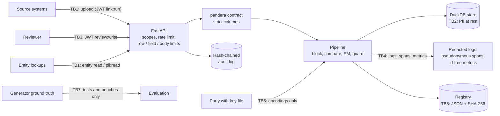

# Threat model

Method: STRIDE per trust boundary. Each row maps a threat to the control that addresses it and to
the test, bench script or CI job that shows the control works. `scripts/check_baseline.py`
verifies that every backticked evidence reference exists.

The records in this repository are synthetic, but the system is built and tested as if they were
real personal data: names, dates of birth and addresses of people, plus the decision that two
records describe the same person.

## System and trust boundaries

Assets: record fields (names, dates of birth, addresses); identity decisions (clusters) and the
reviewer decisions behind them; the Bloom-filter key and the encodings derived from it; model
artifacts; the JWT secret and the pseudonymization key.

Assumptions: TLS terminates in front of the service; tokens are issued by an identity provider that
shares the HS256 secret; the host, the container runtime and the volume holding DuckDB are
trusted; in privacy mode the parties keep the Bloom-filter key away from the linkage unit.

## STRIDE table

| ID | STRIDE | Threat | Entry point / asset | Control | Test / evidence | Residual risk |
|---|---|---|---|---|---|---|
| S1 | Spoofing | Forged, replayed, re-signed or unsigned JWTs (including `alg: none`) | TB1, TB3 | PyJWT pinned to HS256; `sub`, `iat`, `exp`, `iss`, `aud` required; lifetime capped; unknown scopes ignored; routes fail closed without a secret | `tests/unit/test_jwt_redaction_contracts.py::test_invalid_claims_are_refused`, `tests/unit/test_jwt_redaction_contracts.py::test_tampered_foreign_unsigned_and_malformed_tokens_are_refused`, `tests/integration/test_app.py::test_scoped_routes_fail_closed_without_a_jwt_secret` | Symmetric secret shared with the IdP; no revocation before `exp` |
| S2 | Spoofing | Guessing operator API keys to read `/metrics` | `/metrics` | SHA-256 digests compared against every key without early exit; metrics require a key by default | `tests/unit/test_security.py::test_every_configured_digest_is_compared_without_early_exit`, `tests/integration/test_app.py::test_metrics_require_auth_and_label_route_templates` | Operators may make metrics public; restrict by network then |
| S3 | Spoofing | A decision attributed to the wrong reviewer | TB3, audit log | Reviewer identity comes from the verified token subject, stored and audited as a keyed pseudonym | `tests/integration/test_api.py::test_review_decisions_are_audited_and_final` | Mapping pseudonyms back to people needs the IdP and the key |
| T1 | Tampering | Reviewer decisions edited, deleted, reordered or truncated | Audit log | SHA-256 hash chain over canonical JSON; verify CLI; head returned after every decision for external anchoring; appends lock, re-verify and fsync | `tests/unit/test_audit_log.py::test_any_single_byte_change_is_detected`, `tests/unit/test_audit_log.py::test_deleted_reordered_and_truncated_entries_are_detected`, `tests/unit/test_audit_log.py::test_a_tampered_log_cannot_be_opened_for_appending`, `tests/unit/test_audit_log.py::test_two_writers_extend_one_chain` | Someone with write access can rebuild the whole chain; anchor the head outside the host |
| T2 | Tampering | Wrong merges of distinct people through adversarial bridge records | Pipeline, clusters | Over-merge guard: weak-cohesion split, bridge-record (articulation point) split, bridge-edge cuts for conflicts, weak links and the size cap; unresolved clusters stay `pending_review`; cut edges go to review | `tests/integration/test_pipeline.py::test_the_guard_limits_adversarial_bridge_chains_to_two_entities`, `tests/unit/test_clustering.py::test_a_bridge_record_between_two_groups_is_detached`, `tests/unit/test_clustering.py::test_groups_joined_only_by_weak_links_are_split`, `tests/unit/test_clustering.py::test_resolution_is_a_partition_that_respects_constraints`, `bench/bench_robustness.py` | Several bridge records per pair of people remove the single articulation point; a record matching one person strongly is kept with that person |
| T3 | Tampering | Twins or household members silently merged | Pipeline, clusters | `possible_twin` review rule moves twin-like matches to review; weak-cohesion guard separates households; cannot-links from reviewers are respected | `tests/unit/test_thresholds.py::test_the_twin_rule_moves_twin_like_matches_to_review`, `tests/unit/test_clustering.py::test_cannot_links_inside_a_strong_core_are_sent_to_review`, `bench/bench_linkage.py` | Twin and household false-merge rates are measured and reported, not zero |
| T4 | Tampering | Ground-truth entity ids leak into the linker and inflate accuracy | Sources | Truth written to a separate directory; the strict source contract rejects any extra column | `tests/unit/test_jwt_redaction_contracts.py::test_leaked_entity_ids_are_rejected`, `tests/unit/test_vocab_generator.py::test_generation_is_deterministic_and_sources_satisfy_the_contract` | None known |
| T5 | Tampering | A source with a different error profile (or a poisoned batch) quietly shifts linkage quality | TB1, model | Comparison-pattern PSI of likely matches against the model's reference, per batch and per field; alarm above 0.2; scoring with a registered model | `tests/unit/test_attack_monitoring.py::test_pattern_drift_monitor_detects_shifts_and_round_trips`, `tests/integration/test_api.py::test_jobs_can_score_with_the_registered_model`, `bench/bench_robustness.py` | PSI detects distribution shifts, not targeted poisoning of a few records |
| T6 | Tampering | Model artifact swapped, edited or replaced by a pickle payload | Registry | Content-addressed JSON artifacts verified on every load; no pickle anywhere | `tests/integration/test_pipeline.py::test_models_round_trip_through_the_registry_with_a_manifest`, `tests/unit/test_ml_registry.py::test_tampered_blob_is_detected`, `tests/unit/test_no_pickle.py::test_source_tree_has_no_pickle_family_serialization` | Registry records are not signed |
| T7 | Tampering | Compromised dependency, base image or CI action | Build pipeline | uv.lock with hashes; pip-audit; digest-pinned base images; trivy; CycloneDX SBOM; Dependabot | `.github/workflows/ci.yml#pip-audit`, `.github/workflows/ci.yml#docker` | Actions are tag-pinned until SHA pinning at publish time |
| R1 | Repudiation | A reviewer denies a decision, or a merge cannot be explained | Review queue | Audit entry per decision (pseudonymous actor, item, record ids, probability, reason); run hash and manifest per model | `tests/unit/test_audit_log.py::test_entries_are_redacted_before_hashing`, `tests/integration/test_pipeline.py::test_run_hash_is_deterministic_and_sensitive_to_inputs_and_config` | Timestamps come from the host clock |
| I1 | Information disclosure | Names, dates of birth or addresses written to logs | TB4 | Key-based masking of record fields (`first_name`, `dob`, `street`, `left_fields`, ...) and pattern masking of dates and street addresses in free text, after traceback formatting | `tests/unit/test_jwt_redaction_contracts.py::test_structured_record_fields_are_masked_in_logs`, `tests/unit/test_jwt_redaction_contracts.py::test_dates_and_street_addresses_are_masked_in_free_text`, `tests/unit/test_logging.py::test_exception_tracebacks_are_redacted` | Names inside free text cannot be detected by pattern; the code logs counts and pseudonyms only |
| I2 | Information disclosure | Record ids or personal data in metrics and traces | TB4 | Metrics carry no id labels; span attributes are counts, and entity lookups record HMAC pseudonyms of record ids | `tests/integration/test_pipeline.py::test_linkage_metrics_are_published_without_record_ids`, `tests/integration/test_pipeline.py::test_every_stage_emits_a_span_without_personal_data`, `tests/integration/test_api.py::test_metrics_expose_linkage_gauges_but_no_record_ids` | With a random per-process key, pseudonyms change on restart |
| I3 | Information disclosure | Re-identification of names from privacy-mode encodings by frequency alignment | TB5, encodings | Birth-year salts, XOR-folding, balancing with a keyed permutation, per-field keys; the attack test gates the defaults | `tests/integration/test_privacy_gate.py::test_default_hardening_defeats_the_frequency_attack`, `tests/unit/test_privacy.py::test_birth_year_salting_separates_equal_names_born_in_different_years`, `tests/unit/test_privacy.py::test_balanced_name_encodings_have_a_constant_hamming_weight`, `bench/bench_robustness.py` | Pattern-mining and graph-matching attacks are not implemented; birth years are low-entropy salts; keyed blocking tokens are deterministic and reveal their own frequency distribution |
| I4 | Information disclosure | The Bloom-filter key leaks through environment variables, logs, images or loose file permissions | TB5 | Key read only from a mounted secret file: no symlinks, regular file, 32-4096 bytes, owner-only permissions on POSIX; not a settings value; excluded from git and the image | `tests/unit/test_privacy.py::test_key_files_are_validated`, `tests/unit/test_privacy.py::test_key_files_readable_by_others_are_refused`, `tests/unit/test_privacy.py::test_symlinked_key_files_are_refused` | Windows ACLs are not inspected |
| I5 | Information disclosure | Entity lookup exposes a person's records across sources | TB1 | `entity:read` returns record ids and match probabilities only; fields need `pii:read`; review items follow the same rule | `tests/integration/test_api.py::test_entity_lookup_returns_fields_only_with_pii_read`, `tests/integration/test_api.py::test_link_routes_require_a_token_with_the_scope`, `tests/integration/test_app.py::test_scoped_routes_need_a_valid_token_carrying_the_scope` | Ids alone reveal which sources know a person; that is inherent to entity resolution |
| I6 | Information disclosure | Error responses or contract failures echo submitted personal data | TB1 | Fixed error codes; validation details without values; contract failures reported as column/check/count | `tests/integration/test_app.py::test_validation_errors_never_echo_submitted_values`, `tests/unit/test_jwt_redaction_contracts.py::test_field_formats_lengths_and_uniqueness_are_enforced_without_echoing_values`, `tests/integration/test_api.py::test_uploads_are_limited_by_rows_fields_and_body_size` | None known |
| I7 | Information disclosure | Model artifacts leak name frequencies (term-frequency tables) | Registry | Artifacts hold m/u tables, thresholds and configuration only; term frequencies are recomputed per batch | `tests/integration/test_pipeline.py::test_model_artifacts_refuse_mismatched_spaces` | The drift reference stores pattern counts, which are aggregate |
| I8 | Information disclosure | Personal data at rest in DuckDB, Parquet datasets or backups | TB2 | Access only through scoped routes; data, keys and databases excluded from git and the image | `tests/integration/test_api.py::test_entity_lookup_returns_fields_only_with_pii_read`, `.github/workflows/ci.yml#gitleaks` | No encryption at rest in this repository; use an encrypted volume |
| D1 | Denial of service | Oversized uploads (rows, fields, bodies) | TB1 | Body size limit (declared and streamed); static and configured row limits; per-field length and format limits; strict contract | `tests/integration/test_api.py::test_uploads_are_limited_by_rows_fields_and_body_size`, `tests/integration/test_app.py::test_body_size_limit_applies_to_declared_and_streamed_bodies` | Parsing still happens before the row check |
| D2 | Denial of service | Job floods from one or many clients | TB1 | Per-client and global job concurrency caps (429 with Retry-After); token-bucket limit per token subject; invalid credentials share the address bucket | `tests/integration/test_api.py::test_job_concurrency_caps_return_429`, `tests/integration/test_api.py::test_rate_limits_apply_per_token_subject`, `tests/integration/test_app.py::test_invalid_keys_cannot_mint_fresh_rate_limit_buckets` | In-process limits; multi-replica deployments need a shared store |
| D3 | Denial of service | Quadratic candidate generation on very common names | Pipeline | LSH buckets above a cap are paired through a sorted window; reduction ratio enforced in CI | `tests/unit/test_normalize_blocking.py::test_bucket_pairs_match_a_brute_force_oracle`, `.github/workflows/ci.yml#e2e-20k` | A dataset of one repeated name still produces window-bounded but large pair counts |
| D4 | Denial of service | Crafted text makes redaction backtrack | TB4 | Linear-time patterns (lookbehind starts, possessive quantifiers) | `tests/unit/test_redaction.py::test_redaction_stays_fast_on_adversarial_input` | New patterns need the same review |
| D5 | Denial of service | Store not writable or model missing, but traffic still routed | Runtime | `/readyz` verifies the registered model's hashes and a DuckDB write; compose memory, CPU and PID limits | `tests/integration/test_api.py::test_readiness_needs_a_verified_model_and_a_writable_store`, `.github/workflows/ci.yml#docker` | Limits are deployment-specific |
| E1 | Elevation of privilege | A token for one capability performs another (lookups deciding reviews, readers running jobs) | TB1, TB3 | One scope per route family; `pii:read` is separate from `entity:read` | `tests/integration/test_api.py::test_link_routes_require_a_token_with_the_scope`, `tests/integration/test_app.py::test_scoped_routes_need_a_valid_token_carrying_the_scope` | Scope assignment is the IdP's responsibility |
| E2 | Elevation of privilege | Code execution through deserialized artifacts | Registry | JSON and Parquet only; pickle-family imports banned in source and by semgrep | `tests/integration/test_check_baseline.py::test_pickle_family_serialization_in_source_fails`, `.github/workflows/ci.yml#semgrep` | Third-party libraries may deserialize unsafely on their own paths |
| E3 | Elevation of privilege | Escalation inside the container | Runtime | Non-root UID 10001, read-only root filesystem, all capabilities dropped, no-new-privileges | `.github/workflows/ci.yml#docker` | Kernel or runtime vulnerabilities |

## Out of scope

Network attacks below TLS, multi-tenant isolation inside one deployment, key management services,
encryption at rest, and the stronger cryptanalysis of Bloom-filter encodings (pattern mining,
graph matching). The README non-goals list what the implementation deliberately does not do.
